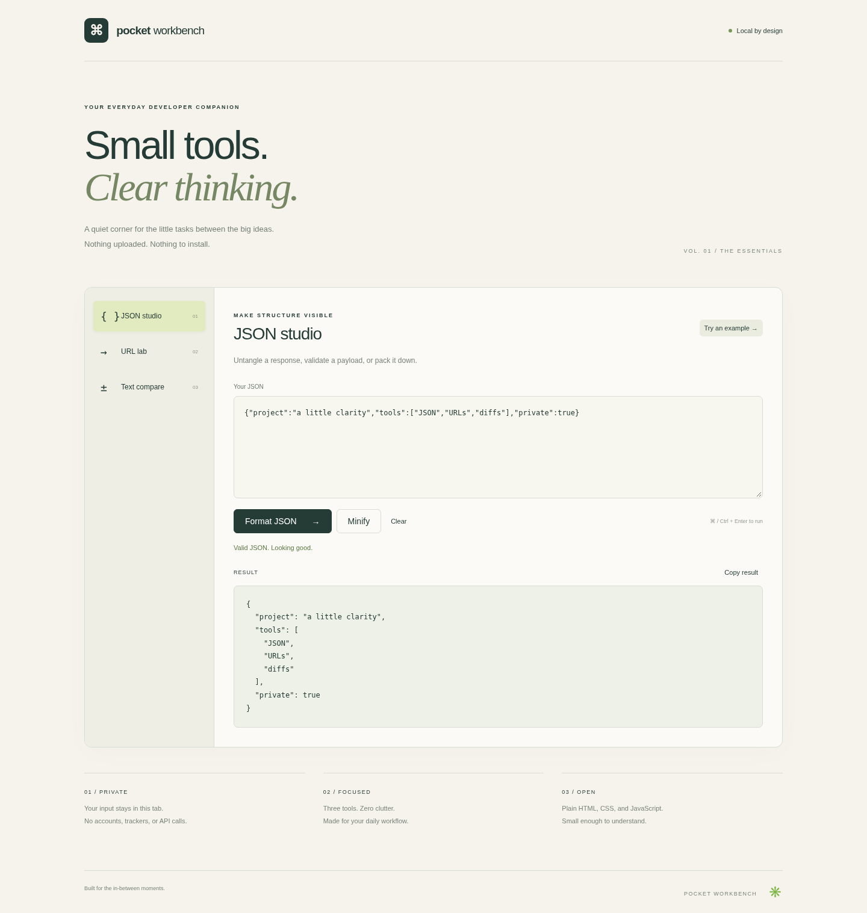

# Pocket Workbench

Small tools. Clear thinking.

A private, browser-based workspace for the development tasks that don't need another account or a trip to an online formatter. Plain JavaScript, no runtime dependencies, and no data sent to a server.



## The tools

- **JSON studio:** validate, format, and minify JSON with readable error feedback.
- **URL lab:** encode and decode URL components, including Unicode and reserved characters.
- **Text compare:** compare two snippets by line, with additions and removals highlighted.

Includes keyboard shortcuts, per-tool input drafts in memory, clipboard copying, examples, and responsive layouts. Inputs are rendered as text, never HTML.

## Run locally

Requires Node.js 20 or newer. There is nothing to install.

```sh
git clone https://github.com/oexwashere/pocket-workbench.git
cd pocket-workbench
npm start
```

Visit `http://127.0.0.1:4173`. To choose another port, run `PORT=8080 npm start` on macOS/Linux or set the `PORT` environment variable in your shell.

You can also serve `index.html` and `src/` with any static web server. ES modules need an HTTP server; opening the HTML file directly with `file://` is unsupported.

## Use it

Choose a tool, paste input, and select an action. **Ctrl+Enter** (Windows/Linux) or **Cmd+Enter** (macOS) runs the primary action. “Try an example” provides a working input for the selected tool.

URL lab treats its input as a **component**, not a complete URL. For example, `hello & world` becomes `hello%20%26%20world`. Decoding uses `decodeURIComponent`; `+` stays `+` rather than becoming a space.

## Verify

```sh
npm run check
npm test
```

The Node test suite covers JSON validity and round trips, Unicode URL handling, malformed encodings, diff reconstruction, repeated lines, empty inputs, and comparison size limits. GitHub Actions runs these checks on Node 20, 22, and 24.

## Design notes

`src/tools.js` contains pure functions; `src/app.js` owns browser interactions. There is no framework or build step. The text comparison uses a longest common subsequence table, bounded to one million cells so oversized inputs produce a helpful error rather than allocating an unbounded matrix.

JavaScript's native JSON parser follows JavaScript number precision; very large numeric identifiers can lose precision. Use strings for identifiers outside the safe integer range. Formatting does not preserve duplicate JSON keys or original number spelling.

## Privacy and limitations

The app makes no external requests, includes no analytics, and does not persist pasted text. Switching tools keeps drafts only until you close or reload the tab. Copying requires clipboard permission and a secure context (HTTPS or localhost); manual copying remains available. Text comparison is line-based, not a full source-code diff engine.

## Deploy

Publish `index.html` and `src/` to any static host. For GitHub Pages, select **Deploy from a branch**, `main`, and `/ (root)` in the repository's Pages settings. Asset paths are relative, so project subpaths work without configuration. No API keys or environment variables are required.

## Contribute

See [CONTRIBUTING.md](CONTRIBUTING.md). Licensed under [MIT](LICENSE).
